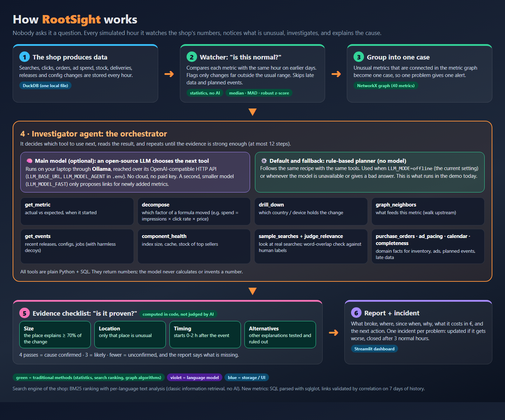

# RootSight - AdSearch Sentinel

An autonomous agent that watches a marketplace's **advertising and search** together. When a release or config change quietly
breaks search, the ads keep spending but clicks and orders fall. RootSight notices within the hour, follows a metric graph from the money
metrics down to the broken component, rules out innocent explanations, and reports what broke, where, since when, why (with evidence) and what it costs.

Built for the hackathon track "Eye of the System: Fully Agentic Monitoring" (Almedia).

## Run it (Windows, conda env `rootsight`)

```bat
cd /d D:\hacklab-almedia
conda activate rootsight
python scripts/check_env.py          :: everything installed? ESCI data present?
python scripts/prepare_data.py       :: ~5 s: products, queries, labels, traffic profile
python scripts/backfill.py           :: ~1-2 min: 14 clean days of history into data/rootsight.duckdb
python scripts/demo.py               :: terminal story: planned event, 4 failures, 2 new metrics
streamlit run app/Home.py            :: dashboard on :8501, and it starts the ShopLens web shop on :8600
```

The dashboard opens at http://localhost:8501 and starts the web shop at http://localhost:8600. Everything is local and free: no account, no API key.

**Demo in three clicks:** on *Shopper journey* pick a step (or *All steps*) and press **Simulate it**. The clock starts at one simulated hour
per second, the step's chart appears, and *What the agent found* shows live what the agent is doing (scoring, anomaly, case, checks)
until its finding appears: a plain-language summary, the failed check (with the SQL, tables, expected and actual value), the
*Possible next action*, and every investigation step with the SQL it ran. Open **See it in the store** to look as a shopper. *Reset demo* (sidebar) goes back to a clean state.

The journey: a shopper searches in the store's other language and gets nothing (English in Germany, German in the US), then the
sponsored product is missing (the German €250/day ad budget burned by mid-morning), then the top sellers are out of stock (supplier delivery
never arrived; sold-out items cannot be added to the cart or checked out). RootSight finds each cause on its own.

You can also **edit any metric** (built-in ones are saved to `rootsight/graph/metrics.yaml`) and **write your own monitoring scenario** in plain
words on *Add a scenario*: the agent maps it onto a failure the simulator can produce, or tells you why it cannot be simulated yet.



## What is real and what is simulated

| Real | Simulated |
|---|---|
| ~116k Amazon products, real EN/ES/JP queries and relevance labels (ESCI). The German store is a demo: US products with word-by-word translated queries | Users, sessions, clicks, carts, orders |
| A real BM25 search engine with per-language analyzers; the failures are real bugs in it | Ads: 3 campaigns, EUR 1,000/day, pacing |
| Statistics, the metric graph, the evidence checklist, incident tracking | Release / config / job event log (with harmless decoys), prices, stock |

## Scenarios

| ID | Failure | Found as |
|---|---|---|
| L1 | searches in the store's other language find nothing (Germany or US) | `search-language[DE/US]` |
| S12 | German search reads text with English rules | `search-analyzer[DE]` |
| AD1 | ad pacing ignores its hourly limits (Germany) | `pacing-service 1.4.0` |
| INV1 | supplier delivery for top sellers is late | `goods-receiving` purchase order |
| S1 | search ranker ignores text relevance | `search-ranker v2.0.0` |
| S3 | Android app sends a null stock filter | `android-app 5.2.0` |
| S2 / S7 / S15 | partial index / recency boost / stale cache | `index-build`, `ranking`, `search-cache` |
| EV1 | Black Friday push (planned, innocent) | info card, no incident |
| DQ1 | search events arrive 2 h late (innocent) | data-delay notice, no incident |

## Tests

```bat
pytest -q                   :: fast suite (~3 min)
pytest -m integration       :: full scenarios end to end (~3 min)
ruff check .
python scripts/smoke_ui.py  :: renders every Streamlit page headless
```

## Docs

**Step-by-step run and test guide: `docs/RUN_DEMO.md`.**

`SETUP.md` (installs), `PLAN.md` (build plan), `docs/algorithm.md` (how it decides), `docs/SCENARIOS.md`, `docs/DOSSIER.md`, `docs/MEMORY.md` (decisions and status).
An optional local or cloud model (any OpenAI-compatible endpoint) can drive the investigator: set `LLM_MODE=live`, `LLM_BASE_URL` and the two model names in `.env`.
With a model, the agent also rewrites each finding in plain words (rejected if it uses a number that is not in the tool results) and reads
user-written scenarios. The rule-based investigator and the code-built wording are the default and the fallback.
